# Typoria

一个独立实现的 macOS 无边框 Markdown 编辑器：保留「点击段落就地编辑、离开后自动排版」的块级写作体验，同时支持 Typora 主题 CSS、LaTeX、Mermaid、HTML / SVG、脚注、目录等扩展语法。

它不是一个 Typora 分支，也不包含 Typora 的专有代码。界面视觉参考了 [TYPOAR](https://github.com/Jiao77/TYPOAR) 的布局与气质；编辑器交互与渲染逻辑均为本项目自己的实现。

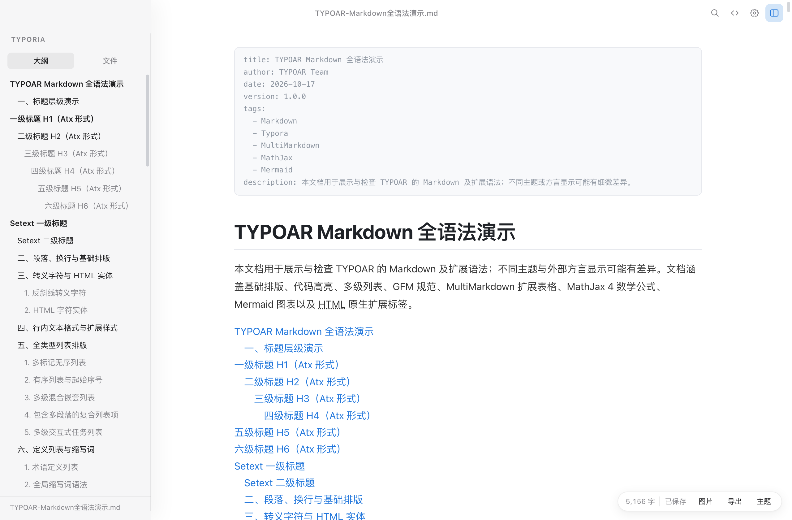

## 立即运行

### 直接打开打包好的应用

```bash
open "dist-package/Typoria.app"
```

如果 macOS 提示「无法验证开发者」或「已损坏」，在 Finder 中右键应用 → **打开**，或双击项目根目录的 **打开 Typoria.command**（会先移除 quarantine 标记再打开）。应用为本地构建，ad-hoc 签名、未做 Apple 公证。

### 从源码运行

```bash
npm install
npm start
```

在受限环境（例如沙箱终端）中，如果 Electron 启动时报告 sandbox 初始化失败，使用：

```bash
npm run start:free
# 或
./start.command
```

`start.command` 会先按普通方式启动，失败后自动尝试 `--no-sandbox`。

## 特性

| 能力 | 说明 |
| --- | --- |
| 无边框桌面窗口 | 原生交通灯 + 自绘覆盖式标题栏，窗口拖动、红绿灯留白与内容滚动融合 |
| 块级就地编辑 | 点击段落编辑源码，光标离开后自动渲染；标题、引用、列表、任务、表格、代码块、公式均可就地编辑 |
| Typora 主题 | 使用应用自己的主题目录，内置 Studio 浅色 / 深色与 TYPOAR 的 GitHub、Night、LaTeX 等主题；可独立运行 |
| LaTeX | 行内 `$...$`、`\(...\)` 与块级 `$$...$$`，使用 KaTeX 渲染 |
| Mermaid / 传统图表 | ` ```mermaid `、` ```flow `、` ```sequence ` 渲染为 SVG；主题切换时重新着色 |
| HTML / SVG | 块级与行内 HTML、SVG 渲染，经 DOMPurify 安全过滤 |
| 图片 | 支持远程 / 图床 URL、data URI、本地相对路径；拖放、粘贴或菜单插入时保存到文档旁的 `assets/`；支持 `{width="25%"}` 等尺寸属性；图片右键菜单可缩放、复制地址、上传图床 |
| 扩展表格 | GFM 对齐表格、MultiMarkdown 跨列 / 跨行、多行单元格、无表头表格、表格标题、转义竖线 |
| 参考链接 | `[文字][id]`、`![图片][id]` 与文末定义区解析 |
| 扩展块 | YAML Front Matter、`[toc]`、脚注、GitHub 风格提示块、Setext 标题、定义列表、缩写、上标 / 下标、Emoji、HTML 实体 |
| 文件能力 | 新建、打开、保存、另存为、最近文件、拖放导入、自动保存草稿 |
| 导出 | 导出 Markdown、完整 HTML、PDF；HTML 导出包含当前主题与扩展渲染结果 |
| 写作辅助 | 大纲侧栏、全文搜索、专注模式、打字机模式、字数统计、源码模式 |

侧边栏与大纲（标题按层级缩进）：

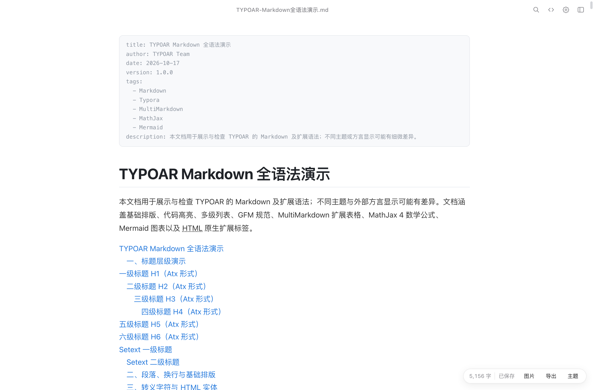

### 主题截图

GitHub 主题（自动读取本机 Typora 主题）：

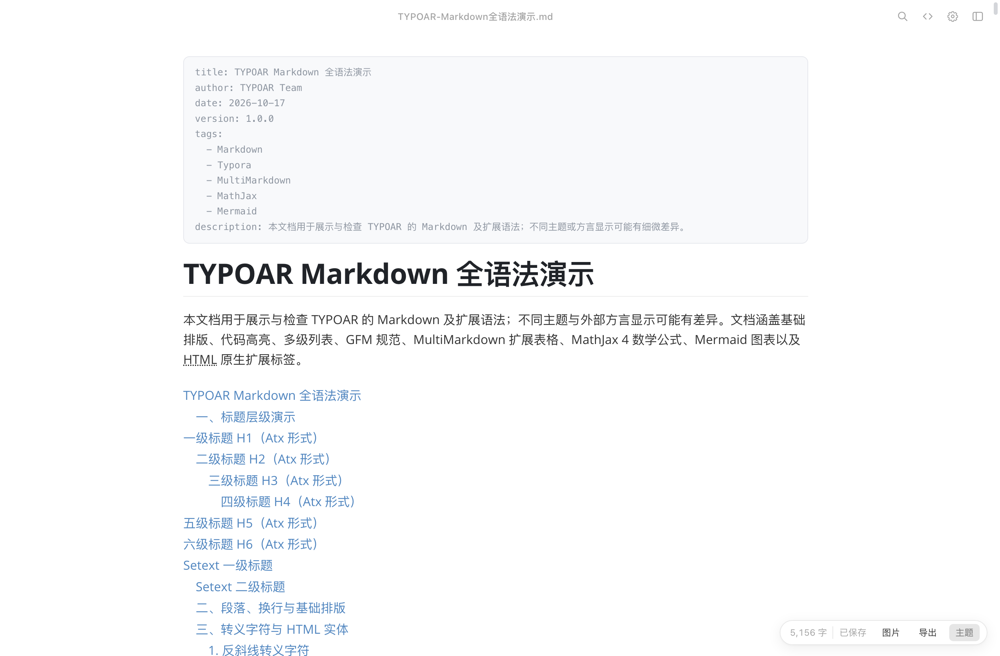

Night 主题：

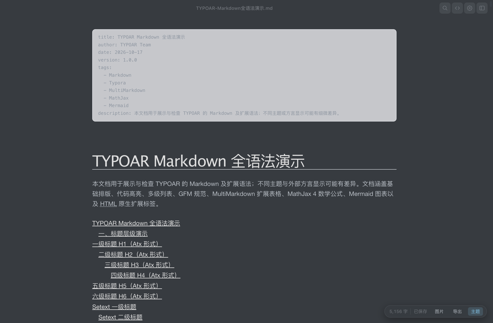

## Typora 主题兼容

Typoria 是独立应用，主题使用自己的目录：

```
~/Library/Application Support/Typoria/themes
```

应用内置 `resources/themes`（包含 GitHub、Night、LaTeX、LaTeX Dark 等），启动时与自己的用户主题目录合并显示。也可以从「偏好设置 → 应用主题文件夹」直接打开目录，或点击「从 Typora 导入主题…」把已有 Typora 主题复制过来（可选，不影响独立运行）。

主题加载流程：

1. 读取 `<theme>.css`、可选的 `base.user.css` 与 `<theme>.user.css`；
2. 把主题中面向 Typora DOM 的选择器转换为本应用的块级 DOM（`#write h1` → `#write .block.type-h1`，`.md-fences` → `.block.type-code` 等）；
3. 把主题里的 `url(...)` 字体、背景图片指向受控的 `studio-theme://` 协议，避免暴露任意文件路径；
4. 跳过 Typora 自身的侧栏、搜索面板、菜单等 UI 选择器，防止覆盖本应用自己的无边框界面。

当前兼容范围包括标题、段落、嵌套引用、列表 / 任务、表格、代码块、行内代码、链接、图片、公式、脚注、目录和 Mermaid 图表。列表与任务清单的间距、部分 `>` 直接子代选择器仍可能与 Typora 有细微差异；数学渲染使用 KaTeX 而不是 Typora 的 MathJax，主题中针对 MathJax DOM 的深层选择器不会全部生效。

状态栏右下角的「主题」按钮可以快速切换 Studio 内置主题或应用自己的主题、打开主题文件夹、刷新主题列表。

LaTeX 主题（从 TYPOAR 主题资源复制并内置）：

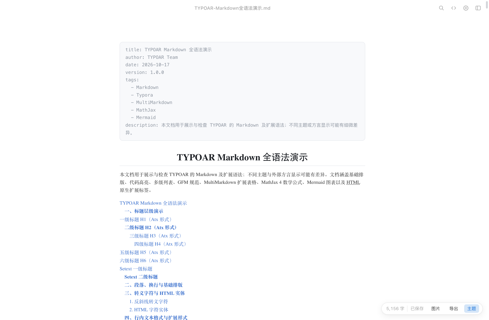

## Markdown 扩展语法

| 语法 | 效果 |
| --- | --- |
| `# 标题` … `###### 标题` | 标题 |
| `**粗体**`、`*斜体*`、`~~删除线~~`、`==高亮==` | 行内样式 |
| `` `行内代码` `` | 行内代码 |
| `[文字](url)`、`` | 链接、图片 |
| `$e^{i\pi}+1=0$` / `$$\int_0^1 x^2 dx$$` | 行内 / 块级公式 |
| `> 引用` | 引用块 |
| `> [!NOTE]` / `[!TIP]` / `[!WARNING]` / `[!IMPORTANT]` / `[!CAUTION]` | 提示块 |
| `- 项目`、`1. 项目` | 无序 / 有序列表 |
| `- [ ] 任务`、`- [x] 任务` | 任务清单，点击复选框切换 |
| ` ```js ` … ` ``` ` | 代码块与基础语法高亮 |
| ` ```mermaid ` … ` ``` ` | Mermaid 图表 |
| ` ```flow ` … ` ``` ` | Flowchart.js 风格流程图（转换为 Mermaid 渲染） |
| ` ```sequence ` … ` ``` ` | js-sequence-diagrams 风格时序图（转换为 Mermaid 渲染） |
| `\| A \| B \|` | GFM 表格；支持对齐、转义 `\|`、`<br/>` 单元格 |
| `\| A \| B \|\|` / `^^` | MultiMarkdown 跨列 / 跨行单元格 |
| 行尾反斜线 `\` | 跨多行单元格 |
| `\|--\|--\|--\|` | 无表头网格表格 |
| 表格后 `[标题]` | 表格图题 |
| `---` | 分隔线 |
| `[toc]` | 根据标题生成目录 |
| `[文字][id]` + `[id]: url` | 参考链接 / 参考图片 |
| `文本` + `===` / `---` | Setext 标题 |
| `术语` + `: 定义` | 定义列表 |
| `*[HTML]: 说明` | 缩写定义（悬浮显示说明） |
| `---` 开头与结尾 | YAML Front Matter |
| `正文[^1]` + `[^1]: 脚注内容` | 脚注引用与定义 |
| `H~2~O`、`x^2^` | 下标、上标 |
| `:smile:` 等 | Emoji 短代码 |
| `<details>…</details>`、`<svg>…</svg>` | 安全过滤后的 HTML / SVG |
| `&copy;`、`&#9733;` | HTML 字符实体 |
| ` ```js {lineno} ` | 带属性的代码围栏（保留属性） |

### 图片右键菜单

在正文图片上右键，可以：

- 选择 **25% / 50% / 75% / 100%**，或输入自定义宽度（如 `320px`、`auto`）
- **恢复原始尺寸**
- **上传到图床**（需先在偏好设置中配置接口）
- 复制图片地址、在访达中显示、编辑图片所在段落

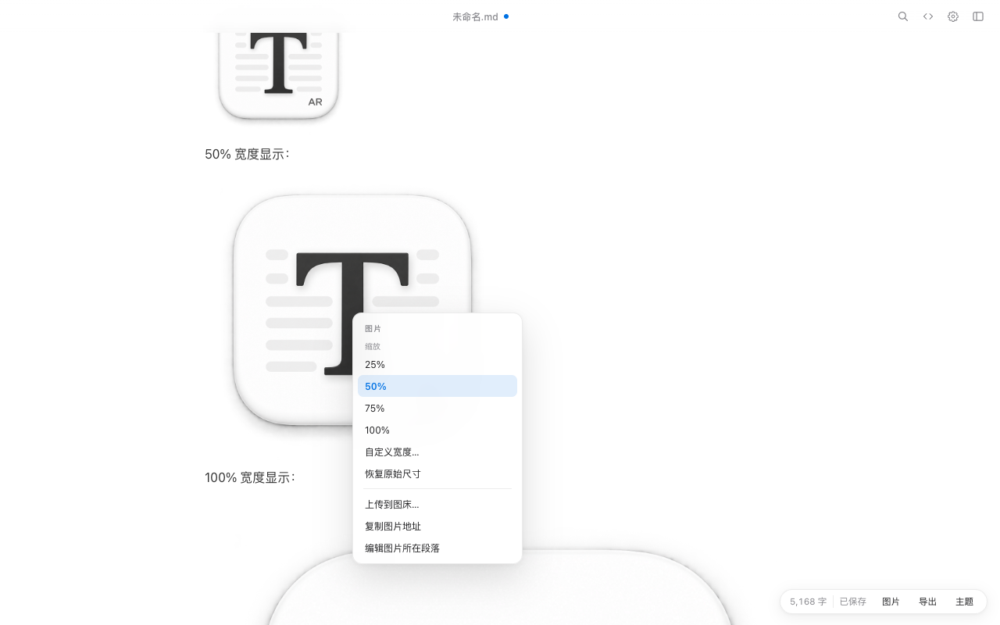

宽度会写回 Markdown 的 `{width="..."}` 属性，参考形式图片也会保留引用形式。

### 图床上传

在「偏好设置 → 图床」填写：

| 设置 | 默认 | 说明 |
| --- | --- | --- |
| 上传接口 | 空 | 接收 `multipart/form-data` 的 POST URL |
| Bearer Token | 空 | 可选，会作为 `Authorization: Bearer ...` 发送 |
| 文件字段 | `file` | 表单中的文件字段名 |
| URL 路径 | `data.url` | 从 JSON 响应中取 URL 的点路径 |

上传支持本地 `file://` 图片、相对路径图片、远程 URL 和 data URI；成功后会把 Markdown 中的图片地址替换为图床 URL，并保留宽度属性。

### 图片尺寸

在图片后加 Markdown-it-attrs 风格的属性即可缩放，属性会保留在源码中：

```markdown
{width="25%"}
{width="50%" height="auto"}
```

也支持参考形式图片：`![图标][ref-logo]{width="25%"}`。

### 图片与本地资源

- 直接写远程地址：``，适合图床。
- 拖入 / 粘贴图片：文档已保存时写入同级 `assets/` 目录，并在 Markdown 中写入相对路径；未保存时写入应用数据目录。
- 本地相对路径、`file://`、`data:` URI 均可显示。
- 目前不内置 PicGo / uPic 之类的图床上传客户端；图床图片以 URL 形式展示。

## 快捷键

| 操作 | 快捷键 |
| --- | --- |
| 新建 / 打开 / 保存 | `⌘N` / `⌘O` / `⌘S` |
| 另存为 | `⇧⌘S` |
| 搜索 | `⌘F` |
| 源码 / 预览切换 | `⌘/` |
| 专注模式 | `⇧⌘F` |
| 侧边栏 | `⇧⌘L` |
| 加粗 / 斜体 / 链接 | `⌘B` / `⌘I` / `⌘K` |
| 标题 1–6 / 正文 | `⌘1…6` / `⌘0` |
| 撤销 / 重做 | `⌘Z` / `⇧⌘Z` |
| 退出当前编辑块 | `Esc` |
| 列表缩进 / 反缩进 | `Tab` / `⇧Tab` |

Windows / Linux 下对应使用 `Ctrl` 与 `Shift`。

## 项目结构

```
typoria/
├─ index.html              # 无边框应用外壳
├─ styles.css              # 外壳、编辑器、扩展与响应式样式
├─ app.js                  # 块级编辑器、解析/渲染、主题适配、文件与导出
├─ electron/
│  ├─ main.js              # 无边框窗口、原生菜单、文件与主题 IPC、PDF 导出
│  └─ preload.cjs          # contextBridge 安全桥
├─ vendor/                 # 本地 KaTeX / DOMPurify / Mermaid（离线可用）
├─ assets/                 # 应用图标
├─ scripts/
│  ├─ vendor.mjs           # 从 node_modules 复制前端依赖
│  └─ package-mac.mjs      # 组装独立 .app
├─ screenshots/            # README 截图
├─ start.command           # 双击启动脚本
└─ dist-package/           # 打包产物（npm run package:mac 生成）
```

## 开发与打包

```bash
npm run vendor        # 重新生成 vendor/ 下的 KaTeX、DOMPurify、Mermaid
npm run dev           # 开发模式（受限环境使用 --no-sandbox）
npm run package:mac   # 生成 dist-package/Typoria.app
```

`package-mac.mjs` 会复制 Electron 运行时，把应用源码放入 `Contents/Resources/app`，改写 `Info.plist`、应用名与图标，并对应用做 ad-hoc 签名。复制 Electron 时会保留 framework 内的相对符号链接，否则签名会失效、Finder 会提示应用已损坏。ad-hoc 签名不满足 Apple 公证要求（`spctl` 会拒绝），但本机直接打开不受影响；如果从网络下载或拷贝后带了 quarantine 属性，右键 → 打开即可。

## 实现说明

- **编辑器交互未重写**：`app.js` 中块激活、光标定位、行内标记显隐、Enter / Backspace、列表与任务快捷转换、代码块、表格、历史记录等逻辑沿用之前已验证的块级编辑器实现。本次新增的是外壳、主题适配与扩展渲染，不改变原有的输入手感。
- **主题适配是独立层**：Typora 主题面向标准 HTML 标签与 Typora 自己的类名；本应用使用 `.block.type-*` 包装块。`transformThemeCss()` 负责选择器转换，`deriveShellFromTheme()` 从主题变量推导外壳配色，避免主题 CSS 直接冲击无边框外壳。
- **安全**：HTML / SVG 经 DOMPurify 过滤，移除 `script`、`iframe`、事件处理器等；主题资源通过自定义协议限定在主题目录内；Electron 开启 `contextIsolation`、关闭 `nodeIntegration`。

## 传统引擎图表

` ```flow ` 与 ` ```sequence ` 会先转换为 Mermaid 再渲染，因此不需要额外加载 Flowchart.js / js-sequence-diagrams。渲染结果、主题切换与导出都走同一套 SVG 管线；源码编辑时仍然看到原始 `flow` / `sequence` 文本。

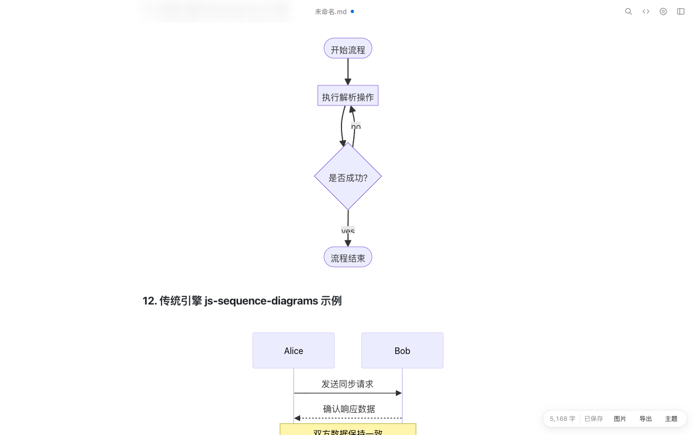

嵌套引用在不同主题下都会按层级缩进（主题负责颜色与边框，应用负责层级布局）：

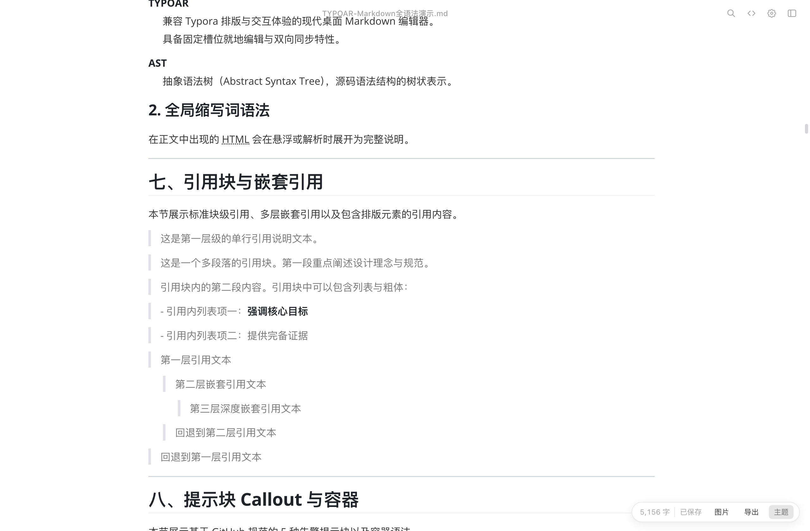

## 提示块

Note / Tip / Important / Warning / Caution 使用不同的颜色、边框和图标，便于快速区分。

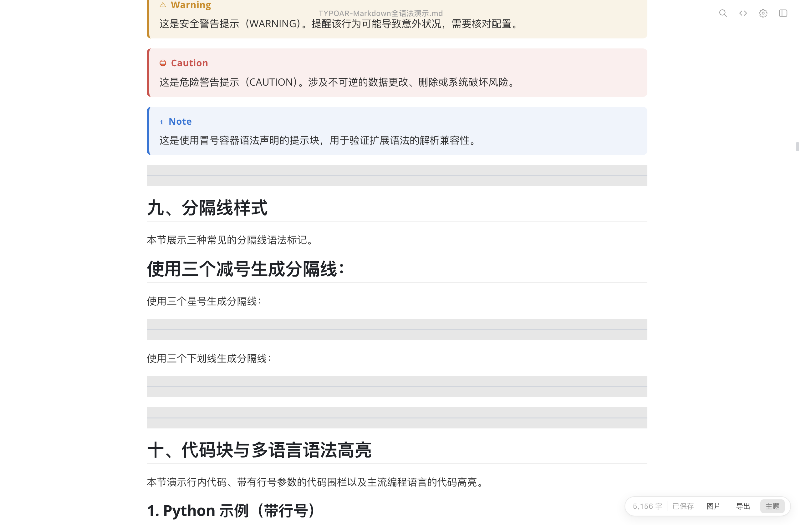

## 兼容性测试

项目内已用用户提供的 `TYPOAR-Markdown全语法演示.md` 做过解析检查，覆盖 Setext、参考链接、图片尺寸属性、GFM / MultiMarkdown 表格、跨列跨行、多行单元格、无表头表格、定义列表、脚注、HTML/SVG、KaTeX 与 10 类 Mermaid 图表。该文件的外部图片路径会按 Markdown 文件所在目录解析。

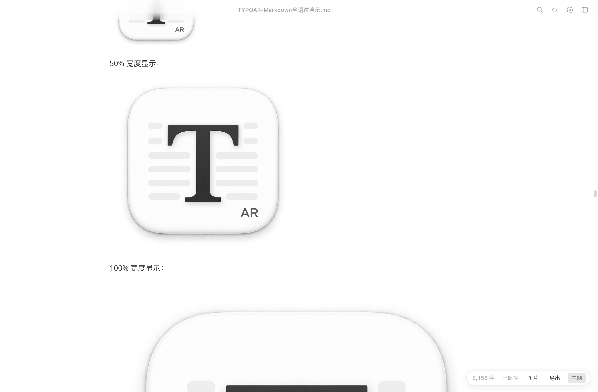

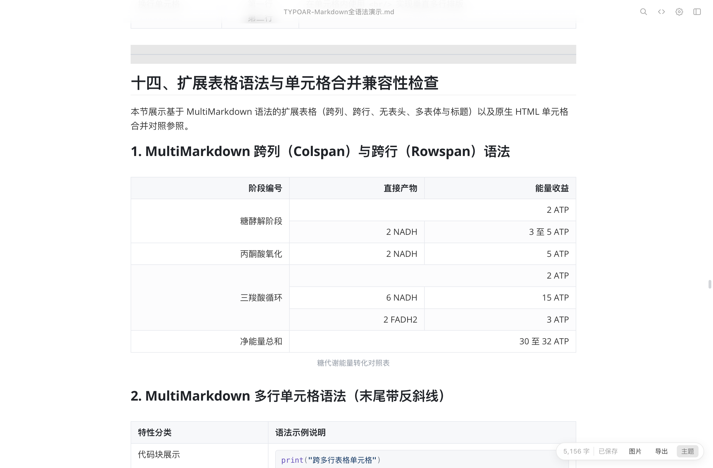

## 已知限制

- Typora 的 MathJax 扩展、图表主题、代码高亮主题选择器只能部分迁移；本项目使用 KaTeX 与 Mermaid 自带主题。
- 列表 / 任务清单的缩进与主题间距为近似适配，不保证与 Typora 像素级一致。
- 多行单元格中的代码块会按表格单元格样式渲染；MultiMarkdown 的极端嵌套合并建议仍以 Typora/原方言为准。
- `flow` / `sequence` 通过转换为 Mermaid 渲染，复杂节点样式与原始 Flowchart.js / js-sequence-diagrams 不会逐像素一致。
- 图床上传是通用 multipart 接口，不内置特定图床客户端；Token 以明文保存在本地设置中。
- 定义列表与缩写支持基础语法；跨多段的复杂定义列表可能按独立块处理。
- 代码高亮是内置的轻量实现，覆盖常见语言的关键字、字符串、注释与数字，不等同于 highlight.js。
- 导出 HTML 中的主题字体、背景图使用 `studio-theme://` 地址，离开本应用后可能无法加载；需要完全可移植的 HTML 时可以再内联资源。
- 应用未做 Apple 公证；首次打开可能需要右键 → 打开。
- 未实现图床上传、协作、插件系统、Typora 的导出模板与 Pandoc 集成。

## 致谢与声明

- 界面布局参考用户提供的 TYPOAR 项目；未复用其编辑器、渲染器、主题加载或图床逻辑。
- 编辑器核心基于本项目此前的独立 Typora 复刻实现。
- 第三方依赖：Electron、KaTeX、Mermaid、DOMPurify，分别遵循其各自许可证。
- Typora 是 Typora 公司的商标；本项目与 Typora 官方无关联，仅用于学习与本地写作。
