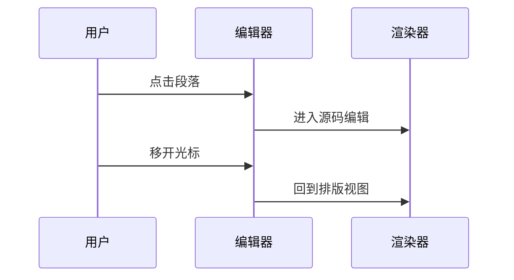
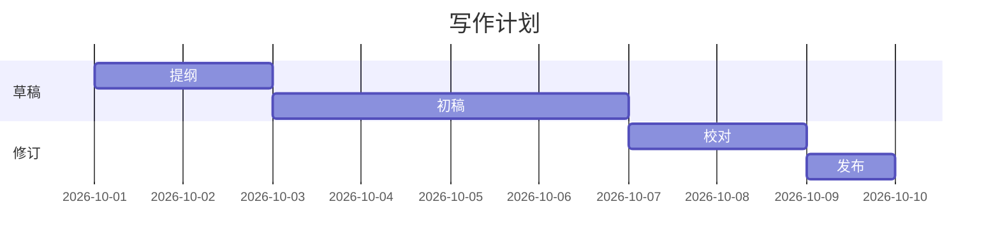
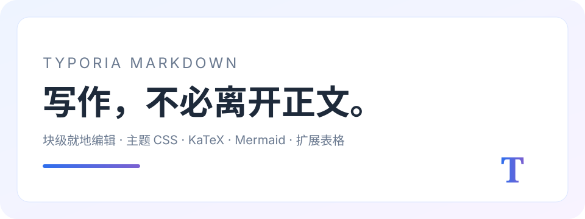

# Typoria Markdown 全语法演示

> 这是一份用于检查 Typoria 渲染与交互的演示文档。它覆盖常用 Markdown、GFM、MultiMarkdown 扩展、KaTeX、Mermaid 与少量 HTML/SVG。

[TOC]

## 一、标题层级与段落

# 一级标题 H1

## 二级标题 H2

### 三级标题 H3

#### 四级标题 H4

##### 五级标题 H5

###### 六级标题 H6

Setext 一级标题
================

Setext 二级标题
----------------

这是普通段落。段落内部支持 **粗体**、*斜体*、~~删除线~~、`行内代码`、[链接](https://example.com) 与 <span style="color:#2f6fed">HTML 行内样式</span>。

这是一个包含硬换行的段落：第一行末尾有两个空格。  
这是强制换行后的第二行。

---

## 二、引用与嵌套

> 第一层引用：写作是把想法固定下来的过程。
>
> > 第二层引用：排版应该帮助阅读，而不是打断写作。
> >
> > > 第三层引用：点击段落即可回到 Markdown，离开后自动排版。

> **引用中的粗体标题**
>
> 1. 引用内有序列表
> 2. 引用内第二项
>
> `引用内代码`

## 三、行内格式与转义

- 粗体：**粗体文字**
- 斜体：*斜体文字*
- 粗斜体：***粗斜体文字***
- 删除线：~~已废弃内容~~
- 高亮：==重点强调内容==
- 下划线插入：++新增文字++
- 上标：E = mc^2^
- 下标：H~2~O
- 表情：😀 🚀 ✅
- 脚注引用：第一处脚注[^1]，第二处脚注[^long]。

转义字符：\*这不是斜体\*、\_这不是下划线\_、\`这不是代码\`、\# 这不是标题。

HTML 实体：&copy; &amp; &lt; &gt; &nbsp;。

## 四、列表与任务

### 无序列表

* 星号列表项一
* 星号列表项二
  * 嵌套项 A
  * 嵌套项 B

### 有序列表

1. 第一步
2. 第二步
   1. 子步骤
   2. 另一个子步骤
3. 第三步

### 任务列表

- [x] 完成 Markdown 渲染
- [x] 支持主题 CSS
- [ ] 继续完善导出
- [ ] 增加更多快捷键

### 定义列表

Markdown
: 一种轻量级标记语言，适合写文档与笔记。

Typoria
: 一个 macOS 上的无边框 Markdown 编辑器。
: 支持块级就地编辑与主题化排版。

### 缩写

*[HTML]: HyperText Markup Language
*[CSS]: Cascading Style Sheets
*[GFM]: GitHub Flavored Markdown

HTML 与 CSS 都是常见的 Web 技术，GFM 扩展了基础 Markdown。

## 五、表格

### GFM 表格

| 语法 | 说明 | 是否支持 |
| :--- | :--- | ---: |
| 粗体 | `**文字**` | 是 |
| 删除线 | `~~文字~~` | 是 |
| 公式 | `$E=mc^2$` | 是 |
| 图表 | Mermaid / flow / sequence | 是 |

### 多行单元格

| 项目 | 内容 |
| --- | --- |
| 第一行 | 单元格中可以写<br>多行内容 |
| 第二行 | 也可以放 `inline code` 和 **粗体** |

### 无表头表格

| --- | --- |
| 没有表头 | 也可以渲染 |
| 第二行 | 继续排版 |

## 六、代码与高亮

```js
function createDocument(title) {
  const doc = { title, createdAt: Date.now() };
  return doc;
}

console.log(createDocument('Typoria'));
```

```python
def words(text):
    return [word for word in text.split() if word]
```

```css
#write {
  max-width: 21cm;
  padding: 1.8cm 2cm;
  font-family: "Songti SC", serif;
}
```

## 七、数学公式

行内公式：质能方程 $E = mc^2$，欧拉恒等式 $e^{i\pi} + 1 = 0$。

块级公式：

$$
\int_{-\infty}^{\infty} e^{-x^2}\,dx = \sqrt{\pi}
$$

化学式：$\ce{2H2 + O2 -> 2H2O}$。

矩阵：

$$
\begin{pmatrix}
a & b \\
c & d
\end{pmatrix}
\begin{pmatrix}
x \\
y
\end{pmatrix}
=
\begin{pmatrix}
ax + by \\
cx + dy
\end{pmatrix}
$$

## 八、图表






## 九、提示块

::: [!NOTE]
提示块用于补充背景信息，不打断正文阅读。
:::

::: [!TIP]
可以把常用主题 CSS 放到主题文件夹中，按需切换。
:::

::: [!IMPORTANT]
当前版本面向 macOS Apple Silicon，首次打开可能需要在 Finder 中右键打开。
:::

::: [!WARNING]
图床上传需要你自己配置接口和 Token，请确认接口可信。
:::

::: [!CAUTION]
导出 HTML 后，主题字体和背景图可能依赖本应用，离开后需要重新内联资源。
:::

## 十、图片与 HTML/SVG




<div style="padding:14px 18px;border:1px solid #dbe6ff;border-radius:12px;background:#f7faff;">
  <strong>HTML 容器</strong><br>
  这里是一段原生 HTML，用于检查渲染器对常见标签的处理。
</div>

<svg width="520" height="100" viewBox="0 0 520 100" xmlns="http://www.w3.org/2000/svg">
  <defs>
    <linearGradient id="g" x1="0" x2="1">
      <stop offset="0" stop-color="#2f6fed"/>
      <stop offset="1" stop-color="#7b61d1"/>
    </linearGradient>
  </defs>
  <rect x="2" y="2" width="516" height="96" rx="14" fill="#ffffff" stroke="url(#g)" stroke-width="3"/>
  <text x="260" y="48" text-anchor="middle" font-family="sans-serif" font-size="20" fill="#1e2a3a">Inline SVG</text>
  <text x="260" y="74" text-anchor="middle" font-family="sans-serif" font-size="13" fill="#6b7a90">支持简单的矢量图形与渐变</text>
</svg>

## 十一、末尾检查

- 行内链接：[Typoria 仓库](https://github.com/Jiao77/typoria)
- 自动链接：<https://example.com>
- 引用式链接：[GitHub][gh]
- 行内脚注：这里是直接写在正文里的脚注^[这是一个行内脚注示例。]

[gh]: https://github.com/

[^1]: 这是第一处常规脚注的说明。
[^long]: 这是一个长内容脚注，用于检查底部脚注区域的排版效果。
